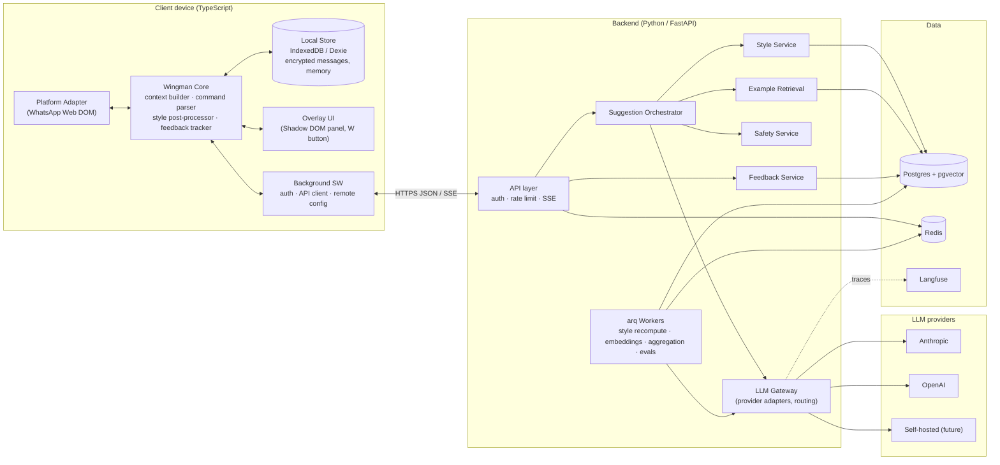
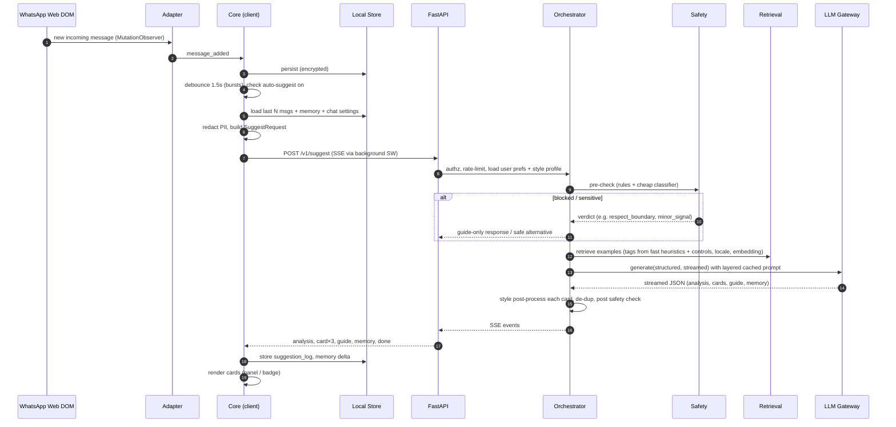

# 03 — System Design

Status: v1 for POC, with production extension points marked **[PROD]**.

---

## 1. Architecture overview



**Key properties**
- **Platform-neutral core.** Only the Platform Adapter knows about WhatsApp. Everything after it works on a normalized `Conversation` model, so mobile and other platforms plug in at one seam.
- **Stateless-about-content backend.** The client sends a bounded context window with each request. The server keeps the *user's own* derived data (style profile, feedback, settings), never the other party's chat history.
- **One request, streamed.** `/v1/suggest` streams analysis, cards and a memory delta over SSE.

---

## 2. Client architecture (extension, POC)

| Module (package) | Runs in | Responsibility |
|---|---|---|
| `platform-adapters/whatsapp-web` | content script | Detect active chat, read and observe messages, read/insert the compose draft, intercept slash commands, provide mount points |
| `core/context` | content script | Build the `SuggestRequest` from the store: last N messages, memory, controls, style hints, redaction |
| `core/commands` | content script | Parse `//…` commands into `{mode, controls, directive}` |
| `core/style-post` | content script | Deterministic style post-processor (same code later in RN; a mirror exists in Python for server-side use, see §8.4) |
| `core/feedback` | content script | Track insert → edit → send → reply and emit feedback events |
| `core/store` | content script (IndexedDB is per-origin of the extension) | `ConversationStore` interface, Dexie implementation, encryption |
| `ui` | content script (Shadow DOM) | Panel, cards, chips, W button, onboarding |
| `background` | service worker | Auth tokens, API calls (avoids page CSP), SSE relay via port, remote config fetch, alarms |

> IndexedDB opened from a content script belongs to the **page origin** (web.whatsapp.com), which
> WhatsApp's own code could read or clear. Therefore **the store lives in the extension origin**: an
> offscreen document or extension page owns Dexie, and the content script talks to it via
> `chrome.runtime` messaging. (Decide in the M0 spike: offscreen document vs. service worker + IndexedDB; both are extension-origin.)

### 2.1 Normalized model (`packages/core/src/model.ts`)

```ts
export type PlatformId = 'whatsapp_web' | 'instagram_web' | 'android_wa' | 'android_ig' | 'ios_share' | string;

export interface ChatRef {
  platform: PlatformId;
  platformChatId: string;      // raw id from the platform (never sent to server)
  chatKey: string;             // HMAC-SHA256(installSecret, platform + platformChatId), sent to server
  title: string;               // contact display name (local only; server gets an alias)
  isGroup: boolean;
}

export type MessageKind = 'text' | 'image' | 'video' | 'voice' | 'sticker' | 'gif' | 'link' | 'deleted' | 'system' | 'story_reply' | 'reel_share';

export interface NormalizedMessage {
  id: string;                  // platform message id (or hash of ts+dir+text)
  chatKey: string;
  dir: 'in' | 'out';           // in = from the other party, out = from the user
  kind: MessageKind;
  text: string;                // '' for pure media; caption if any
  ts: string;                  // ISO time (best effort; platforms expose minute precision)
  replyToId?: string;          // quoted message
  reactions?: string[];        // emojis on this message
  meta?: { durationSec?: number; edited?: boolean };
}
```

### 2.2 Platform adapter contract (`packages/core/src/adapter.ts`)

```ts
export interface PlatformAdapter {
  readonly id: PlatformId;
  readonly capabilities: {
    readHistory: boolean;        // can scroll back / read full thread
    observeIncoming: boolean;
    insertDraft: boolean;        // can place text in the compose box
    interceptCommands: boolean;  // can catch //commands before send
    overlay: 'inline-panel' | 'bubble' | 'keyboard-strip' | 'none';
  };
  init(config: AdapterSelectorConfig): Promise<void>;
  getActiveChat(): ChatRef | null;
  readVisibleMessages(): NormalizedMessage[];
  loadOlder?(maxMessages: number): Promise<NormalizedMessage[]>;   // back-scroll import
  onEvent(cb: (e: AdapterEvent) => void): () => void;              // chat_switched | message_added | draft_changed | command
  readDraft(): string;
  insertDraft(text: string, mode: 'replace' | 'append'): Promise<boolean>;
  mountPoints(): { panelHost: HTMLElement | null; buttonHost: HTMLElement | null };
  selfTest(): AdapterHealth;                                        // reported to telemetry
}
```
Mobile adapters (roadmap) implement the same contract with different `capabilities`. For example, an iOS
share-OCR adapter has `observeIncoming: false, insertDraft: false, overlay: 'keyboard-strip'`, and the
UI degrades accordingly.

### 2.3 WhatsApp Web adapter: approach (validate in the M0 spike)
- **Chat detection**: observe the main conversation pane header; derive `platformChatId` from message
  element ids (WA embeds the chat JID in message `data-id` values) or fall back to a hash of the header title.
- **Message reading**: `MutationObserver` on the message list container. Each row carries direction
  (incoming/outgoing class or id prefix), and a `data-pre-plain-text` attribute like
  `[10:15 pm, 01/11/2026] Name: ` gives time and sender. Media, voice and deleted messages are mapped to `kind` by icon/aria labels.
- **Compose box**: `footer [contenteditable="true"][role="textbox"]`. WhatsApp uses a rich-text editor
  (Lexical), so setting `textContent` does not work. Insert via a synthetic `paste` event with
  `DataTransfer` (preferred) or `document.execCommand('insertText')`, then verify by reading back.
- **Command interception**: capture-phase `keydown` listener on the compose box. If the draft matches
  `^//` (or `/w `), call `preventDefault()` + `stopImmediatePropagation()` *before* WA's handler, clear the
  draft and dispatch the command. Belt and braces: while a command is typed, a visible chip says
  "Wingman command, Enter won't send". If the listener isn't attached (self-test failed), the chip is
  absent, so the user can see it.
- **Selectors are data**: all selectors live in `AdapterSelectorConfig` JSON fetched from
  `/v1/config` (signed, cached, versioned) with a bundled default. Fixing a DOM change = publish
  new JSON, no store review. MV3 forbids remote *code*, not remote *data*.
- **Self-test** runs on load and on chat switch (found compose box? found message list? parsed
  ≥1 message?). Failures report `adapter_health` events (no content) so breakage is noticed within the hour.

### 2.4 Local store schema (Dexie, extension origin)

| Table | Key | Fields | Notes |
|---|---|---|---|
| `chats` | `chatKey` | platform, platformChatId, title, alias, isGroup, stage, settings{tone, objective, lang}, firstSeenAt, lastMsgAt, styleOverrideVersion | |
| `messages` | `[chatKey+id]` | dir, kind, `enc_text`, ts, replyToId, reactions | text AES-GCM encrypted; index on `[chatKey+ts]` |
| `memory` | `chatKey` | summary (enc), facts[] (enc), coveredUntilTs, version | rolling summary of messages older than the live window |
| `suggestion_log` | `requestId` | chatKey, cards[], controls, createdAt, insertedCardId, sentMessageId | joins insert→send for implicit feedback |
| `feedback_queue` | auto | event payload | flushed in batches to `/v1/feedback` |
| `style_samples` | auto | text (enc), ts, chatKey | user's own outgoing messages pending upload for style learning (consented) |
| `kv` | key | installSecret, encKey handle, config cache, flags | |

Retention: default unlimited on device. A per-chat "forget this chat" button and global wipe. Max 20k messages per chat (oldest pruned after they are summarized).

---

## 3. Backend architecture

```
services/api/app
├── main.py                 # FastAPI app, routers, middleware (auth, rate limit, scrubbing logger)
├── api/                    # routers: auth, me, suggest, style, memory, feedback, config, admin
├── suggest/orchestrator.py # pipeline (§5)
├── suggest/prompting.py    # prompt assembly, cache layering
├── style/                  # feature extractor, style card job, post-processor (py mirror)
├── memory/                 # summary/facts refresh
├── retrieval/              # example bank queries, ranking
├── safety/                 # pre/post checks, policy
├── feedback/               # ingestion, preference updates, aggregation jobs
├── llm/                    # gateway + providers/{anthropic,openai,selfhosted}.py + routes.yaml
├── prompts/                # versioned Jinja2 templates: suggest/v1/system.j2 …
├── db/                     # SQLAlchemy models, Alembic migrations
└── workers/                # arq tasks
```

### 3.1 Server data model (Postgres)

```sql
users(id uuid pk, email citext unique, google_sub text unique, display_name text,
      locale text,                      -- 'pk' | 'in' | …, drives cohort
      age_confirmed_at timestamptz, plan text default 'alpha',
      created_at, deleted_at)

user_settings(user_id pk fk, default_tone text, default_objective text, lang_pref text,
      emoji_level smallint, auto_suggest bool default true,
      data_donation bool default false, style_learning bool default true, updated_at)

refresh_tokens(id, user_id, token_hash, expires_at, rotated_from, revoked_at)

chat_refs(id uuid pk, user_id fk, chat_key text,          -- HMAC from client, not reversible
      platform text, stage text, settings jsonb, created_at,
      unique(user_id, chat_key))

style_profiles(id uuid pk, user_id fk, scope text check (scope in ('global','chat')),
      chat_ref_id uuid null fk, version int,
      features jsonb,                   -- deterministic metrics (§8.1)
      spelling_map jsonb,               -- {"kya":"kia","hai":"hy",...}
      style_card text,                  -- LLM-written description
      exemplars_enc bytea,              -- user's own sample messages, encrypted (app-level KMS key)
      sample_count int, updated_at,
      unique(user_id, scope, chat_ref_id, version))

suggestion_requests(id uuid pk, user_id, chat_ref_id, mode text, trigger text,
      controls jsonb, prompt_version text, route text, model text,
      latency_first_ms int, latency_total_ms int, tokens_in int, tokens_cached int,
      tokens_out int, cost_usd numeric(10,6), safety_flags text[], created_at)
      -- NO conversation content

suggestions(id uuid pk, request_id fk, rank smallint, kind text, approach text,
      text text,                        -- our generated text (not third-party data)
      example_ids uuid[], created_at)

feedback_events(id bigserial pk, user_id, suggestion_id null, request_id null,
      type text,  -- shown|inserted|copied|sent_verbatim|sent_edited|reply_received|thumbs_up|thumbs_down|regenerated|tweaked|dismissed
      value jsonb, -- {edit_distance:0.12, reason:'too_cringe', latency_to_reply_s: 340, edited_text?: (only if donation)}
      client_ts, created_at)

user_preferences(user_id pk, prefs jsonb, updated_at)   -- learned weights (§9.2)

examples(id uuid pk, tier text check (tier in ('global','cohort','user')),
      owner_user_id uuid null, cohort text null,            -- e.g. 'pk-ur', 'in-hi'
      text text, context_snippet text null,                 -- the message it answers (synthetic or donated+scrubbed)
      lang_mix numeric,                                     -- 0=all English … 1=all Roman Urdu/Hindi
      tags text[], tone text, objective text, stage text,
      quality real default 0.5, uses int default 0, wins int default 0,
      source text,   -- curated|llm_generated_reviewed|mined_donation|user_accepted
      status text,   -- draft|approved|retired
      embedding vector(1024), embedding_model text, created_by, created_at)
  -- indexes: gin(tags), btree(tier, cohort, status), hnsw(embedding vector_cosine_ops)

scenario_tags(tag text pk, parent text, description text, examples_count int)

donated_samples(id, user_id_hash, context_scrubbed jsonb, suggestion_text, outcome jsonb, created_at)  -- opt-in only

prompt_versions(id text pk, task text, template_hash text, created_at, notes)
experiments(id, name, variants jsonb, allocation jsonb, status, created_at)
assignments(user_id, experiment_id, variant, assigned_at)
```

---

## 4. API (v1)

All endpoints use JSON, `Authorization: Bearer <jwt>`, and are versioned under `/v1`. Rate limits per user and plan.

| Method & path | Purpose |
|---|---|
| `POST /v1/auth/google` | Exchange a Google ID token for access + refresh JWT |
| `POST /v1/auth/refresh` | Rotate refresh token |
| `GET /v1/me` · `PATCH /v1/me/settings` · `DELETE /v1/me` | Profile, settings, full account + data deletion |
| `GET /v1/config?platform=whatsapp_web&v=…` | Remote config: selectors, feature flags, command list, kill switch (signed) |
| `POST /v1/suggest` (SSE) | Main endpoint: reply/topic/guide/rewrite/auto |
| `POST /v1/memory/refresh` | Summarize older messages → `{summary, facts}` (returned to client, not stored) |
| `POST /v1/style/samples` | Upload the user's own outgoing samples (consented) → enqueue profile recompute |
| `GET /v1/style/profile?chat_key=` | Current global/chat profile (for the settings UI: "how Wingman thinks you text") |
| `POST /v1/style/quiz` | Cold-start quiz answers |
| `POST /v1/feedback` | Batch of feedback events |
| `POST /v1/chats/{chat_key}` · `DELETE …` | Upsert chat settings (stage, default tone) / forget chat server-side refs |

### 4.1 `POST /v1/suggest`: request
```jsonc
{
  "request_id": "uuid-from-client",
  "chat": { "key": "hm_7f3…", "platform": "whatsapp_web", "stage": "talking",
            "their_alias": "Ayesha",          // first name or user-chosen alias; client may anonymize
            "is_group": false },
  "mode": "auto",                              // auto | reply | topic | guide | rewrite
  "trigger": "incoming_message",               // incoming_message | button | command | tweak | regenerate
  "controls": { "tone": "playful", "objective": "keep_going", "length": "short",
                "language": "auto", "count": 3 },
  "directive": "she said she's stressed about her viva",   // free text from //? or the panel input
  "draft": null,                               // required for mode=rewrite
  "avoid": [],                                 // previous card texts on regenerate/tweak
  "tweak": null,                               // "shorter" | "funnier" | "more_flirty" | "more_urdu" | ...
  "memory": { "summary": "…", "facts": ["exam (viva) on 4 Nov", "loves chai, hates coffee"],
              "covered_until": "2026-10-28T19:00:00Z" },
  "messages": [                                // most recent ≤ 40, oldest→newest, already redacted
    { "dir": "out", "kind": "text", "text": "kesa gaya din?", "ts": "2026-11-01T16:58:00Z" },
    { "dir": "in",  "kind": "text", "text": "thak gai hun yaar viva ki tension hai", "ts": "2026-11-01T17:03:00Z" }
  ],
  "client": { "app": "ext", "version": "0.1.0", "style_profile_version": 7 }
}
```

### 4.2 `POST /v1/suggest`: SSE response events
```
event: meta        data: {"request_id":"…","prompt_version":"suggest/v3","model_route":"suggest"}
event: analysis    data: {"their_mood":"stressed","energy":"low","interest":"medium","hooks":["viva on 4 Nov"],"recommended_move":"support_then_light"}
event: card        data: {"id":"…","rank":1,"kind":"reply","approach":"supportive","text":"arey tension na lo, tum ne itni prep ki hai, ache se ho jayega 🤞"}
event: card        data: {"id":"…","rank":2,"kind":"reply","approach":"playful distraction","text":"viva ke baad chai pe chalein? tension ka ilaaj wahi hai"}
event: card        data: {"id":"…","rank":3,"kind":"topic","approach":"light topic","text":"btw kal raat wala match dekha? 😂"}
event: guide       data: {"text":"She's stressed. Lead with support, keep it short, and don't push plans too hard tonight."}
event: memory      data: {"facts_add":["viva on 4 Nov causes stress"],"summary_patch":null}
event: done        data: {"latency_ms":1840}
event: error       data: {"code":"safety_block","message":"…","alternatives":[…]}
```
The client renders each `card` as it arrives. The `memory` delta is persisted locally.

---

## 5. Suggestion pipeline



### 5.1 Steps in detail
1. **Trigger and debounce.** Auto mode waits 1.5 s after the last incoming message (people send bursts) and only runs for the **active** chat. Results are cached keyed by `(chatKey, lastMessageId, controls)`. Opening the panel shows cached cards instantly.
2. **Context window.** Last 40 messages or ~2.5k tokens, whichever is smaller. Older content is represented by `memory.summary` + `facts`. If `messages` would exceed the window and memory is stale, the client first calls `/v1/memory/refresh` in the background (§10).
3. **Redaction (client).** Phone numbers, emails, CNIC/Aadhaar-like numbers, street addresses and URLs with tokens are replaced by placeholders (`<PHONE>`). Contact names are reduced to first name or alias.
4. **Pre-safety (server).** Rules + lightweight classification on the latest inbound messages and the directive (§13).
5. **Retrieval.** Scenario tags come from cheap heuristics plus controls in the POC; in **[PROD]** they come from the previous turn's `analysis.hooks/recommended_move` or a small classifier. Fetch 4–6 examples (§9).
6. **Generation.** One LLM call with a structured output schema (`SuggestOutput`, §5.3). Field order is `analysis` first, then `cards`, so the model reasons about the room before writing.
7. **Post-processing.** Style post-processor (§8.4); de-dup (cards must differ by approach and normalized text); anti-AI-tell scrub (em-dashes → comma/none, remove "Hey there", trailing formal punctuation if the user never uses it); length clamp.
8. **Post-safety.** Fast deterministic checks, plus an LLM check only if flagged.
9. **Stream.** Cards are emitted as soon as each one is complete and validated.

### 5.2 Mode behaviour
| Mode | Output |
|---|---|
| `auto` | Model picks the mix: typically 3 replies, or 2 replies + 1 topic if the convo is dying; guide if useful |
| `reply` | 3 replies with distinct approaches |
| `topic` | 3 topic openers grounded in memory/facts and cultural calendar (exams, Eid, Diwali, cricket series, weather) |
| `guide` | 1–2 lines of strategy + up to 2 example lines |
| `rewrite` | 2–3 rewrites of `draft` preserving intent and the user's voice; one "minimal edit" variant |

### 5.3 Structured output schema (Pydantic → JSON Schema → provider-native)
```python
class Analysis(BaseModel):
    their_mood: Literal["happy","excited","neutral","tired","stressed","sad","annoyed","flirty","distant","busy"]
    energy: Literal["low","medium","high"]
    interest: Literal["low","medium","high","unclear"]      # soft signal; never shown as a "score"
    hooks: list[str] = Field(max_length=4)                  # things worth picking up
    recommended_move: str                                   # short label
    boundary_signal: bool                                   # they asked to stop / clear disinterest

class Card(BaseModel):
    kind: Literal["reply","topic"]
    approach: str          # must be unique across cards
    text: str              # ready to send, may contain '\n' to mean "send as 2 messages"
    why: str | None        # ≤ 12 words, shown on hover

class SuggestOutput(BaseModel):
    analysis: Analysis
    cards: list[Card] = Field(min_length=1, max_length=3)
    guide: str | None
    memory_delta: MemoryDelta | None   # new durable facts, if any
```
`text` containing `\n` is rendered as stacked bubbles. The user's style may be multi-message bursts
("haha" / "acha sun"). Insert puts the first part in the compose box and offers "insert next" after send.

### 5.4 Latency budget (p50 target ≤ 2.5 s POC)
| Step | Budget |
|---|---|
| Client build + redaction | 30 ms |
| Network to API (PK/IN → Mumbai/SG) | 60–120 ms |
| Auth, prefs, profile (Redis-cached) | 20 ms |
| Retrieval (pgvector HNSW + tag filter) | 30 ms |
| LLM time-to-first-card (cached prefix, low effort) | 0.8–1.8 s |
| Post-process + stream | 20 ms |
Precompute on incoming message hides most of this in practice.

---

## 6. Prompt design

### 6.1 Layers (ordered for prompt caching: most stable first)
| # | Block | Changes | Cache |
|---|---|---|---|
| L1 | **System core**: role ("the user's witty, emotionally intelligent friend who texts in Roman Urdu/Hindi + English"), output contract, human-likeness rules, safety policy, cultural notes | per prompt version | breakpoint 1 |
| L2 | **User style block**: style card, feature summary, spelling map, 8–12 exemplars, learned preferences | per user, when profile updates (days) | breakpoint 2 |
| L3 | **Chat block**: stage, alias, memory summary + facts, chat-level style override | per chat, when memory refreshes | breakpoint 3 |
| L4 | **Turn block**: retrieved examples, recent messages, controls, directive, avoid-list, tweak | every request | none |

Retrieved examples are placed in L4 even though they look static. They change per request, and putting them earlier would invalidate L3.

### 6.2 Human-likeness rules (excerpt for L1)
- Write like a real person texting on WhatsApp in Pakistan/India, not like an assistant.
- Mirror the user's spellings, casing, punctuation and emoji habits exactly (style block wins over defaults).
- Keep it short. Most real texts are 2–12 words. Never write paragraphs unless the user does.
- No em-dashes, no semicolons, no "Hey there!", "I hope", "Absolutely!", "That's amazing!" style filler.
- Don't stack questions. At most one question per card, and not every card should be a question.
- Use callbacks to earlier details (memory facts) when natural. That is what makes texts feel personal.
- Use cultural references only if they fit (chai, biryani debates, cricket, exams, Eid, shaadi season, Coke Studio, Bollywood), never forced.
- Pickup lines and cheesy shayari only when the tone is `flirty`/`funny` *and* the user's style allows it.
- Each card must take a genuinely different approach (e.g. playful / sincere / question-led).
- Examples are references for tone and phrasing. Never copy them verbatim.

### 6.3 Prompt registry & versioning
Templates in `app/prompts/<task>/<version>/*.j2`. `prompt_version` is recorded on every request.
Changes go through the eval harness (§12). Experiments assign users to variants via the `experiments` table.

---

## 7. LLM Gateway

```python
@dataclass
class LLMRequest:
    route: str                        # "suggest", "style_analysis", …
    system_blocks: list[PromptBlock]  # each with cache: bool
    messages: list[PromptMessage]
    output_schema: type[BaseModel] | None
    max_output_tokens: int
    stream: bool
    metadata: dict                    # user_id hash, request_id, prompt_version (no content)
```
- `routes.yaml` maps route → ordered `[provider:model, options]`. Options include effort level, timeout and max tokens.
- **Failover policy**: provider timeout (first token > 4 s), 5xx/429 after SDK retries, or refusal → next target. Circuit breaker per target (Redis).
- **Structured output**: Anthropic → `output_config.format` JSON schema. OpenAI → `response_format` json_schema strict. Self-hosted → guided decoding (vLLM). The gateway validates with Pydantic either way and does one repair retry on failure.
- **Streaming partial JSON**: the gateway uses an incremental JSON parser to emit each completed `cards[i]` early.
- **Caching**: the gateway places provider cache markers on block boundaries (L1–L3); OpenAI does automatic prefix caching on the same ordering.
- **Accounting**: tokens in/cached/out and cost written to `suggestion_requests`; Langfuse trace with redacted payloads.

---

## 8. Style engine (Requirement 1)

### 8.1 Deterministic features (computed from the user's outgoing messages)
| Feature | Example value |
|---|---|
| `avg_words`, `p90_words` | 5.2, 11 |
| `burstiness` (msgs per turn) | 1.8 |
| `casing` | `lower` / `sentence` / `mixed` |
| `end_punct_rate` | 0.05 (rarely ends with ".") |
| `question_rate` | 0.22 |
| `emoji_rate`, `top_emojis` | 0.35, [😂, 😭, 🙂] |
| `laugh_tokens` | ["hahaha", "lol", "😂"] |
| `lang_mix` (Roman Urdu/Hindi share) | 0.62 |
| `script` | roman / mixed with Nastaliq / Devanagari |
| `spelling_map` | {"kya":"kia","hai":"hy","nahi":"ni","yaar":"yr","acha":"achaa"} |
| `abbrev` | ["u","ur","btw","k","plz"] |
| `elongation` | "sooo", "hahaaa" frequency |
| `honorific/pronoun` | `tum` vs `aap` vs `tu` (per chat!) |

The spelling map is built by clustering tokens onto canonical lemmas with a curated Roman Urdu/Hindi
variant dictionary (`data/lexicon/variants.yaml`, e.g. `nahi|nai|ni|nhi|nahin`), then taking the user's most frequent variant.

### 8.2 LLM style card (async job, `style_analysis` route)
From ~100–300 of the user's messages, produce a 120-word description ("Writes all-lowercase, short bursts
of 2–3 messages, teases a lot, uses 'yr' and 'hy', laughs with 'hahaha' not 'lol', rarely uses emojis except 😭…")
plus 8–12 **diverse exemplars** (picked by embedding clustering, PII-scrubbed).

### 8.3 Scopes
- **Global profile** (all chats). Default.
- **Chat override**, built when a chat has ≥ 30 outgoing messages. Captures register differences (e.g. `aap` vs `tum`, more emojis with a close friend). The request uses the chat override if present, else global.
- **Cold start**: (a) back-scroll import of the user's own messages from up to 5 chats the user selects (consent screen), or (b) a quiz with 6 "which would you send?" pairs plus 3 free-text answers.

### 8.4 Post-processor (deterministic, shared TS + Python mirror, golden-tested for parity)
Applied to every generated card:
1. Token-level spelling substitution via `spelling_map` (lemma-aware, so it never touches English words).
2. Casing transform (e.g. lowercase everything except "I" if the user does).
3. Punctuation normalization (drop trailing "." if `end_punct_rate` < 0.1; collapse "!!" if never used).
4. Emoji budget (trim to the user's rate; swap to the user's top emojis if semantically close: 😂↔🤣).
5. Laugh-token mapping ("haha" → user's "hahaha").
6. Burst split (if `burstiness` > 1.5 and text > 8 words, split at a natural boundary into `\n`).
Edits the user makes after inserting feed back into the map (§11.2).

---

## 9. Example bank & retrieval (Requirement 7)

### 9.1 Tiers
| Tier | Owner | Source | Visibility |
|---|---|---|---|
| **Global** | Wingman team | Curated by native speakers, LLM-generated then human-reviewed | All users |
| **Cohort** | Wingman team | Same, specialised by `cohort` (`pk-ur`, `in-hi`, `in-en-heavy`, age band later) | Matching users |
| **User** | Each user | Cards the user inserted and sent (near-verbatim), plus their own high-signal messages | Only that user |

### 9.2 Scenario taxonomy (v1, hierarchical tags)
`opener.*` (first_text, after_match, story_reply, reel_share) · `flow.*` (keep_going, dry_reply, one_word_reply,
she_asked_question, they_shared_news, banter, teasing_back, compliment_received, give_compliment) ·
`depth.*` (deep_talk, family, career, dreams, vulnerable_share) · `plan.*` (suggest_meet, date_idea, confirm_plan, after_date) ·
`repair.*` (left_on_read, long_gap, awkward_moment, apology, misunderstanding) ·
`daily.*` (good_morning, good_night, food, weather, exams, work_stress, sick) ·
`culture.*` (eid, ramadan, diwali, holi, cricket, shaadi_season, coke_studio, bollywood) ·
`boundary.*` (they_said_no, slow_down, end_gracefully).
Stored in `data/taxonomy/scenarios.yaml`, synced to `scenario_tags`.

### 9.3 Retrieval algorithm
```
candidates = examples WHERE status='approved'
             AND (tier='global' OR (tier='cohort' AND cohort=:user_cohort) OR (tier='user' AND owner=:uid))
             AND tags && :scenario_tags
             AND (tone = :tone OR tone IS NULL)
score = 0.45*cos_sim(embedding, embed(last_inbound + hooks))
      + 0.20*quality                      # Bayesian win-rate (wins+1)/(uses+2)
      + 0.15*tier_boost                   # user > cohort > global
      + 0.10*lang_mix_closeness(user.lang_mix)
      + 0.10*recency/novelty (penalize examples shown to this user in last 7 days)
take top 6 with MMR diversity (λ=0.7) → inject 4–6 into L4
```
If no examples match the tags, relax to the parent tag, then to tone-only.

### 9.4 Curation workflow
`data/examples/*.yaml` (source of truth, PR-reviewed) → `make seed-examples` → embedded by a worker →
`approved`. **[PROD]** internal curation UI, donated-sample mining queue, a quality decay job.

---

## 10. Per-chat memory (Requirement 2)

- **Live window**: last ≤ 40 messages sent raw.
- **Rolling summary** (≤ 150 words) + **facts** (≤ 20 bullets: names, dates, likes/dislikes, plans, inside jokes, sensitive topics to avoid).
- Refresh when messages since `covered_until` would push the window over budget, or every 50 new messages. `POST /v1/memory/refresh` with `{old_summary, facts, messages_to_fold}` returns a new `{summary, facts}`. **The client stores it; the server keeps nothing.**
- Incremental fact capture via `memory_delta` on each suggest response.
- The user can view and edit memory per chat in the panel ("Wingman remembers: …"). This builds trust and corrects mistakes.
- **[PROD]** optional E2E-encrypted sync of the store to the user's other devices (client-side keys; server stores ciphertext only).

---

## 11. Feedback & continuous improvement (Requirement 3)

### 11.1 Signals
| Signal | Captured by | Strength |
|---|---|---|
| Card shown / dismissed | UI | weak |
| Inserted / copied | UI | medium + |
| Sent verbatim (edit distance ≤ 0.2) | adapter matches the next outgoing message to the inserted text | strong + |
| Sent edited | same, with diff (diff tokens only; full edited text only if donation) | medium +, plus style learning |
| Inserted but not sent / deleted | adapter | medium − |
| Regenerate / tweak | UI | medium − (with direction: "shorter") |
| 👍 / 👎 + reason chips (*cringe, too long, not my style, wrong vibe, too formal, too flirty, didn't get context*) | UI | strong ± |
| Reply received within X min, reply length | adapter (next inbound after a sent suggestion) | outcome signal (noisy) |

### 11.2 Learning loops
1. **Immediate, per user (online).**
   - `user_preferences` is updated with EMA weights: preferred length, tone distribution, emoji tolerance, question rate, cringe sensitivity. These go into L2 as explicit instructions ("keep it shorter than you think").
   - Edit diffs update the `spelling_map` and phrase preferences (e.g. the user always deletes "yaar" → down-weight it).
   - Inserted-and-sent cards become **user-tier examples**.
   - Recent 👎 reasons for this chat go into L4 as an avoid-list.
2. **Periodic, global (offline, nightly).**
   - Aggregate win rates per example, prompt version, route/model and tone. Update `examples.quality`, retire losers.
   - From opted-in donated samples: scrub PII → mine candidate examples → human review → promote to cohort/global.
   - Regenerate the eval set from real failure clusters.
3. **Experiments.** A/B prompt and model variants with assignment by user. Primary metric: insert rate. Guardrails: thumbs-down rate, latency, cost. **[PROD]** contextual bandit over tone mixes and card types.
4. **[PROD] Model improvement.** Preference pairs (sent-verbatim vs. dismissed or regenerated) feed DPO/LoRA fine-tuning of an open model for a cheaper `suggest` route, gated by the eval harness.

---

## 12. Evaluation harness
- `data/eval/scenarios/*.yaml`: 100 (POC) → 1,000 (prod) scenarios, each with persona style samples, messages, controls and rubric notes. Covers all taxonomy branches, PK and IN cohorts, and safety red-team cases.
- Metrics: deterministic style distance (features of output vs. persona), AI-tell count, length compliance, card diversity; LLM-judge (1–5) for naturalness, style match, context use, cultural fit, safety; pairwise preference between variants.
- `make eval ROUTE=suggest VARIANT=…` runs the whole set and writes a report (Markdown + Langfuse dataset run). CI runs a 30-scenario smoke subset on prompt/route changes.
- Native-speaker review: 50 samples per release, blind pairwise.

---

## 13. Safety design

| Situation | Detection | Behaviour |
|---|---|---|
| Other party says stop / not interested / blocked-ish language | rules (multilingual phrases: "mujhe message mat karo", "not interested", "leave me alone") + `analysis.boundary_signal` | Only `boundary.*` guidance: respect it, a graceful short reply or none; no persuasion cards |
| Possible minor (mentions class 8/9/10, matric, age < 18) | rules + classifier | No romantic/flirty suggestions; neutral notice to the user |
| User asks for manipulation, threats, harassment, blackmail, doxxing, sexual coercion | directive classifier | Refuse that ask; offer a respectful alternative |
| Explicit sexual content | policy setting (default: flirty OK, explicit off) | Downgrade to playful/flirty-safe |
| Self-harm signals from either side | classifier | Supportive guide + resource line (country-specific: PK/IN helplines) |
| Persistent one-sided texting (user sent many messages without reply) | heuristic on message direction counts | Guide suggests giving space; no "double text" cards |
| Hate/abuse in generated text | post-check | Drop card, regenerate once |

Policy text in `app/safety/policy.md`, versioned with prompts. Red-team scenarios are part of the eval set.

---

## 14. Privacy & security

- **Data minimization.** The server receives a bounded, redacted window per request and processes it in memory only. No request bodies in logs, APM or error reports (scrubbing middleware + Sentry `before_send`).
- **What is stored server-side.** Account, settings, the user's *own* style profile (encrypted exemplars), our generated suggestions, feedback events, request metadata. With opt-in donation: PII-scrubbed context samples.
- **Chat identity.** `chatKey` = HMAC(install secret, platform chat id). The server can't recover phone numbers or names.
- **LLM providers.** Use API tiers whose terms exclude training on API data; prefer zero-retention arrangements where available; list sub-processors in the privacy policy.
- **Deletion.** `DELETE /v1/me` hard-deletes all user rows (and Langfuse traces by user hash) within 30 days. The extension's "wipe" clears the local store.
- **Consent.** Explicit onboarding screens for (1) processing the open chat to generate suggestions, (2) style learning from the user's own messages, (3) optional data donation. Age attestation 18+.
- **Compliance targets.** India DPDP Act 2023 (notice, consent, grievance officer, deletion), Pakistan PECA 2016 and the draft PDP Bill, Chrome Web Store User Data Policy (Limited Use), later Google Play / App Store privacy labels.
- **Threats.** Token theft (short-lived JWT, refresh rotation, origin checks); a malicious page reading the store (extension-origin IndexedDB, §2); prompt injection via the other party's messages ("ignore your instructions…"): messages go in a clearly delimited data block, the model is told chat content is data, and output is constrained by schema + post-checks; supply chain (lockfiles, audits).

---

## 15. Remote config, flags & kill switch
`GET /v1/config` returns a signed JSON (Ed25519, public key bundled in the extension):
`{ version, min_client_version, kill_switch: {whatsapp_web: false}, selectors: {...}, commands: {...}, flags: {auto_suggest: true, rewrite: true}, limits: {...} }`.
The client caches it for 1 h, verifies the signature, and falls back to the bundled config.

---

## 16. Non-functional requirements

| Area | POC | Production |
|---|---|---|
| Availability | best effort (single region) | 99.9 % API; multi-AZ; LLM multi-provider failover |
| Scale | ≤ 50 users, ≤ 5 rps | 100k DAU → ~30–60 rps peak at night (PK/IN evening peak 9 pm–1 am) |
| Latency | p50 2.5 s / p95 5 s to first card | p50 1.2 s (precompute, smaller routes) |
| Cost | tracked per request | budget alerts; per-plan quotas |
| Security | baseline (§14) | pen-test before public launch; bug bounty later |

---

## 17. How the design extends to other platforms (preview; details in roadmap)

| Surface | Capture incoming | Show suggestions | Insert | Commands | Adapter caps |
|---|---|---|---|---|---|
| WhatsApp Web (POC) | DOM observer | Inline panel | Compose box paste | `//` in compose | full |
| Instagram Web | DOM observer | Inline panel | Compose box | `//` | full |
| Android (WA/IG) | NotificationListener (+ optional Accessibility) | Wingman Keyboard strip / bubble | IME commits text | typed `//` in keyboard | partial → full |
| iOS (WA/IG) | Share screenshot → OCR, or copy → keyboard reads pasteboard | Wingman Keyboard | Keyboard inserts | keyboard buttons | partial |
| Telegram/Messenger/Dating web | DOM observer | Inline panel | Compose | `//` | full |

The backend API, prompts, style engine, example bank and feedback model are **unchanged** across surfaces. Only the adapter and the UI shell differ.
