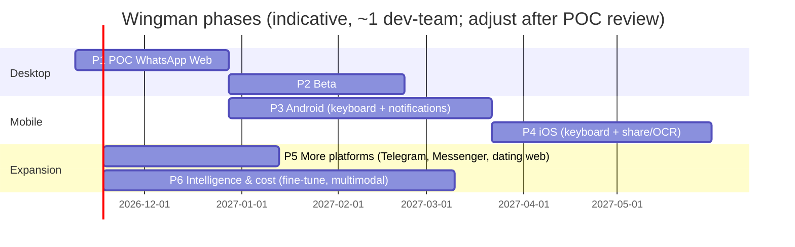

# 05 — POC → Production Roadmap (all platforms, all integrations)

The POC proves **suggestion quality + style matching** on desktop WhatsApp Web. Production takes
the same backend and core to every surface where people actually text, mainly **mobile**.

Guiding rule: **the backend API, prompts, style engine, example bank and feedback model don't fork
per platform.** Each new surface is a new `PlatformAdapter` + UI shell that produces the normalized model (03 §2.1).

---

## 1. Phase map

| Phase | Theme | Key deliverables | Exit metrics |
|---|---|---|---|
| **P1 POC** | Prove quality | See `04-poc-implementation-plan.md` | 01 §7 POC targets |
| **P2 Desktop beta** | Second platform + real users | Instagram Web adapter; public Chrome/Edge/Firefox listing; phone-OTP auth; subscriptions; E2E-encrypted sync v1; curation UI | 1k WAU, insert rate ≥ 40 %, D30 retention ≥ 20 % |
| **P3 Android** | Mobile reach | RN app + Wingman Keyboard + NotificationListener capture; optional Accessibility "Pro overlay" (policy-gated); Play Store launch | 10k installs, keyboard activation ≥ 50 % of installs |
| **P4 iOS** | Full mobile | Keyboard extension + share-screenshot OCR + copy-to-suggest; App Store launch | parity metrics vs Android within 20 % |
| **P5 Expansion** | More apps | Telegram Web, Messenger, Snapchat web, Tinder/Bumble/Hinge web; Android adapters for the same apps via notifications | per-platform insert rate ≥ 35 % |
| **P6 Intelligence** | Better + cheaper | Fine-tuned small model route, DPO from feedback, voice-note transcription, story/image understanding, bandit tone selection, on-device model for the keyboard | cost/request ↓ 70 %, quality ≥ baseline |

P3 can start in parallel with P2 if there are two devs: the backend is shared and the mobile team only builds adapters and shells.

---

## 2. Platform integration designs

### 2.1 Instagram Web (P2)
- Same extension, new adapter `platform-adapters/instagram-web` (matches `https://www.instagram.com/direct/*`).
- IG DOM uses obfuscated class names, so we rely on `role`, `aria-label`, structure and text heuristics, with selectors via remote config as before.
- New message kinds: `story_reply`, `reel_share`, `post_share`, `like_heart`, `voice`. These map to `kind` with a short text descriptor ("[replied to your story]", "[shared a reel]"). Topic mode gains `opener.story_reply` and `flow.reel_share` scenarios. That is a big use case: "she sent a reel, what do I say?"
- **[P6]** reel/story understanding: an optional thumbnail or caption sent to a vision-capable route (user-initiated only).
- Instagram's official Messaging API covers business/creator accounts only, so it's not viable for personal DMs.

### 2.2 Android (P3)
Android can't inject UI into other apps the way a browser extension can. Three OS-sanctioned capabilities combine into a full experience:

| Capability | API | Gives us | Policy notes |
|---|---|---|---|
| **Wingman Keyboard** (core) | `InputMethodService` (Kotlin) | A suggestion strip above the keys inside WhatsApp/IG; insert text into any field; `//` commands typed in the keyboard; captures the user's *own* typing for style learning (consented) | Standard and Play-friendly; the user must enable the keyboard. Must not log keystrokes in password fields (`inputType` check) |
| **Incoming capture** (core) | `NotificationListenerService` | Reads incoming WhatsApp/IG message notifications (sender + text, often several stacked messages) → builds per-chat history locally | User grants notification access. Gaps: muted chats, messages read while the app is open (no notification), media placeholders |
| **Full-screen context** (optional "Pro overlay") | `AccessibilityService` + overlay bubble (`SYSTEM_ALERT_WINDOW`) | Reads the visible chat on screen (both sides) for complete context, plus a floating W bubble | Play Store restricts Accessibility to accessibility purposes and requires a declaration + review, so **high rejection risk**. Plan: ship without it on Play; consider a direct-download build or drop it. Decide in P3 with legal |

Flow: an incoming notification is stored → when the user opens WhatsApp and taps the text field, the
Wingman Keyboard shows "3 ideas ready" → tap to insert → the user sends with WhatsApp's send button.
The keyboard sees what gets typed and committed, which yields the implicit "sent verbatim/edited" feedback.

Chat matching: notifications identify conversations by title (contact name) + package. The keyboard knows
the host package (`EditorInfo.packageName`) but **not which chat is open**. Resolution order: (1) most
recent notification chat for that package, (2) a chat chip on the keyboard strip to switch, (3) Accessibility (if enabled) for certainty.

Stack: Expo (dev client) RN app for onboarding/settings/history/paywall. Kotlin modules for IME,
NotificationListener and Accessibility, exposed to RN via Expo Modules API. Local store: SQLite + SQLCipher,
key in Android Keystore. The keyboard process talks to the API directly (OkHttp + SSE) and shares the store via a bound service / ContentProvider.

### 2.3 iOS (P4)
iOS lets no app read another app's screen or notifications. Available paths:

| Capability | API | Gives us | Limits |
|---|---|---|---|
| **Wingman Keyboard** | Custom Keyboard Extension (Swift/SwiftUI), *Full Access* for network | Suggestion strip, insert, commands, captures the user's own typing | ~50–70 MB memory cap, so a native UI and no RN inside the keyboard. Unavailable in secure fields. The user must allow Full Access (trust copy matters) |
| **Share screenshot → OCR** | Share Extension + Vision `VNRecognizeTextRequest` (on-device) | The user screenshots the chat and shares it to Wingman. OCR extracts bubbles; left/right position decides direction; the result is stored as chat history | Manual step. Bubble geometry heuristics per app/theme. Roman script OCR is good; Urdu Nastaliq is weaker |
| **Copy → suggest** | Keyboard reads `UIPasteboard` (Full Access; iOS may show a paste prompt) | Long-press their message → Copy → the keyboard shows "Suggest replies to copied text" | Only the copied message as fresh context, combined with stored history |
| **App Group** | Shared container | Keyboard, share extension and app share the local store (SQLite) | — |
| **App Intents / Shortcuts** (later) | Back-tap or Action button → "Wingman this screenshot" | Faster screenshot flow | — |

Expected iOS UX: "screenshot + share" once to sync context, then the keyboard for day-to-day use.
Messaging must be honest that iOS needs a tap or two more than Android.

### 2.4 Native desktop apps
WhatsApp Desktop (Windows/Mac) and the IG app can't host extensions. Options: (a) steer users to the
web versions (simplest); (b) **[later]** a Tauri tray app with OS accessibility APIs (macOS AX / Windows
UI Automation) to read the focused chat + a global hotkey overlay. Only if demand is proven.

### 2.5 Further platforms (P5)
| Platform | Desktop path | Android path | iOS path |
|---|---|---|---|
| Telegram | Web adapter (web.telegram.org) | notifications + keyboard | keyboard + share |
| Facebook Messenger | Web adapter (messenger.com / facebook.com/messages) | same | same |
| Snapchat | Web adapter (web.snapchat.com) | same | same |
| Tinder / Bumble / Hinge | Web adapters where web apps exist | same | same |
| SMS / RCS | — | notifications + keyboard (or default SMS role, no) | keyboard + share |
Each one is an adapter + selector config + new `PlatformId` + adapter-specific scenarios (e.g. dating-app openers based on profile prompts).

---

## 3. Cross-device & sync (P2+)
- **E2E-encrypted sync** of the local store (chats, messages, memory) across the extension and mobile:
  the client derives a key from a user passphrase / device-pairing QR (X25519 key exchange). The server
  stores opaque encrypted blobs per chat (`sync_blobs(user_id, chat_key, version, ciphertext)`). The
  local-first decision (D2) holds: the server can't read content.
- Style profiles are already server-side, so they need no sync.
- Conflict resolution: per-message append-only log; memory summary is last-writer-wins with a version.

---

## 4. Backend evolution

| Area | POC | Production |
|---|---|---|
| Compute | 1 container + 1 worker | Autoscaled API (ECS Fargate/Cloud Run) + worker pool, multi-AZ, Mumbai primary |
| DB | single managed PG | HA Postgres (RDS/Cloud SQL) + read replica; PITR backups; partition `feedback_events` and `suggestion_requests` by month |
| Cache/queue | Redis single | Managed Redis HA; move heavy jobs to a dedicated queue if needed |
| LLM | Gateway, 2 providers | + self-hosted fine-tuned route (vLLM on GPU, autoscaled), per-plan routing, regional endpoints, budget guardrails |
| Config | signed JSON | + feature-flag service (PostHog/Unleash) with per-platform targeting |
| IaC | compose + platform config | Terraform; staging/prod parity; blue-green deploys |
| Observability | Sentry, Langfuse, logs | + OpenTelemetry traces, SLO dashboards, on-call runbooks, cost anomaly alerts |
| Security | baseline | pen-test, SOC2-lite controls, secret rotation, WAF, bot protection on auth |

Capacity sketch for 100k DAU: about 20 suggestion requests per DAU per day = 2M/day. That is ~23 rps
average, ~70 rps evening peak. The LLM provider rate limits are the binding constraint (negotiate tiers;
multi-provider spread), not our API.

---

## 5. Intelligence roadmap (P6)
1. **Route tiering**: the cheap tier handles routine `auto` precomputes; the top tier handles explicit requests and hard modes (rewrite, recover). Decided by eval + cost dashboards.
2. **Distillation & fine-tuning**: train a small open model (e.g. 7–14B class) with LoRA on (a) curated examples, (b) top-tier outputs that were sent verbatim (distillation), (c) DPO pairs from feedback. Serve on vLLM. Target ≥ baseline judge scores at ≤ 30 % of the cost.
3. **Per-user adaptation**: retrieval of the user's tier examples is the main lever. Per-user LoRA is not planned (cost/complexity).
4. **Contextual bandits** over card mixes (reply/topic), tone ordering and length per user and stage.
5. **Multimodal**: voice-note transcription (Whisper-class model that handles Urdu/Hindi + English code-switching; on-device on mobile where possible), image/reel/story understanding (user-initiated).
6. **On-device small model** for the mobile keyboard (instant shorter suggestions, privacy mode), with server for the full quality path.
7. **Scripts**: Urdu Nastaliq and Devanagari input/output and transliteration toggle.
8. **Coaching mode**: post-conversation insights ("you asked 6 questions in a row; try sharing more about yourself"), opt-in.

---

## 6. Monetization & growth (to validate in P2)
- **Freemium**: N suggestion sets/day free (e.g. 15), unlimited + rewrite + premium tones + multi-platform sync on paid.
- **Pricing**: localized (PKR/INR). Payment rails: Play Billing / App Store IAP on mobile; web checkout with JazzCash/Easypaisa (PK) and UPI/Razorpay (IN) for the extension.
- **Unit economics guardrail**: LLM cost per paying user per month ≤ 25 % of ARPU (drives the P6 cost work and the tier decision).
- **Growth loops**: shareable "Wingman saved me" moments (without chat content), referral credits, creator partnerships (dating/relationship creators in PK/IN).

---

## 7. Compliance & policy workstream (continuous, mandatory before public launch)
| Item | When |
|---|---|
| Legal review of Meta ToS exposure (WA/IG), positioning as a user-side assistant with no automation | before P2 public listing |
| Privacy policy, terms, DPDP (India) notices, consent manager, grievance officer; Pakistan PECA/PDP bill review | P2 |
| Chrome Web Store, Edge, Firefox listing compliance (Limited Use, permission justifications) | P2 |
| Google Play: IME + NotificationListener disclosures; Accessibility decision; Data safety form | P3 |
| App Store: keyboard Full Access justification, privacy nutrition labels, Sign in with Apple | P4 |
| Age assurance (18+), content policy, abuse reporting channel | P2 |
| Data residency decision (Mumbai for IN; review PK) + sub-processor list | P2 |
| Safety red-team per release; transparency page ("what Wingman sees and stores") | ongoing |

---

## 8. Team evolution (indicative)
| Phase | Roles |
|---|---|
| P1 | 1–2 full-stack (TS + Python), 1 part-time curator |
| P2 | + 1 backend/ML eng, + 1 designer (part-time), curators ×2 (PK + IN) |
| P3–P4 | + 1 Android (Kotlin), + 1 iOS (Swift), + QA |
| P5–P6 | + ML engineer (fine-tuning/serving), + growth/marketing, + trust & safety lead |

---

## 9. What the POC must already get right (so later phases don't need rework)
1. The `PlatformAdapter` contract and normalized model (03 §2): every later surface implements it.
2. The OpenAPI contract and generated client: mobile reuses `packages/api-client`.
3. Style post-processor parity (TS + Python + later Kotlin/Swift ports sharing the same golden vectors).
4. Local-first store behind the `ConversationStore` interface: Dexie now, SQLite later.
5. Gateway routing in config: tier and provider changes need no code.
6. Feedback event schema: platform-agnostic event types so all surfaces feed one learning loop.
7. Remote config + kill switch per platform.
